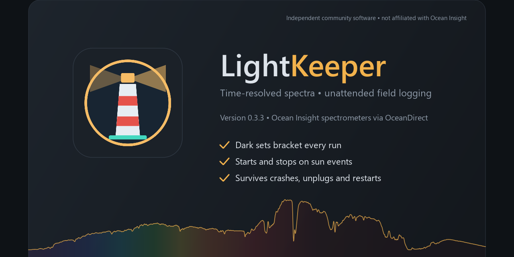
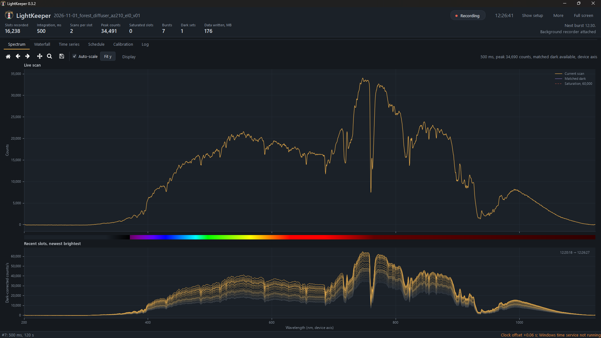
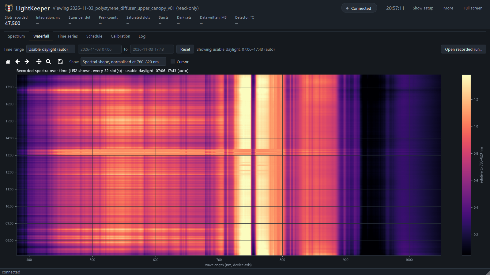
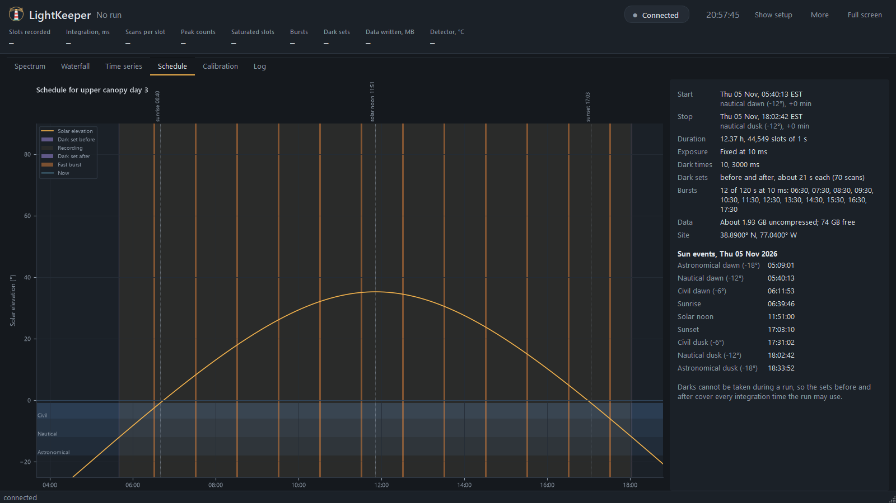

<p align="center">
  
</p>

<p align="center">
  <b>Unattended, dark-bracketed time-resolved spectroscopy with Ocean Insight spectrometers on Windows.</b>
</p>

LightKeeper records a raw spectrum on a fixed time grid, every second, from before dawn to after dusk. You don't need to
watch it. Each run is bracketed by dark sets that cover every integration time the run may use, so no darks are needed
in the field. Fast bursts store every scan at scheduled times. A background recorder survives a closed window, a crash,
a USB fault or a Windows restart. It is the sibling of [GammaKeeper](https://github.com/Fisicas/GammaKeeper), with the
same rules and look, but for optical spectra (ultraviolet to near-infrared) instead of gamma-ray spectra. The trace behind the logo is real: daylight through a diffuser
at a forest edge, with the vegetation red edge near 700 nm and both branches of the O₂ A-band at 760 nm, at the detector's full resolution.

## What it does

- **Raw data on a fixed grid.** Each slot (default 1 s) stores the per-pixel mean and standard deviation of every scan
  in that slot, plus the exposure, saturation and timing. Files are HDF5 and rotate hourly. Nothing is dark-subtracted,
  smoothed or resampled.
- **Fixed exposure by default.** A run records at one integration time (500 ms) unless you choose automatic exposure,
  which moves along a ladder of integration times.
- **Dark sets you can trust.** Before and after the run, LightKeeper records darks at every integration time the run
  can use: the fixed time (or the whole ladder), the burst time, and a second long time for the dark-drift model.
  Each dark set also lists the detector's hot and cold pixels, which the display hides; the raw data keep them.
- **Sun-event scheduling.** Start and stop can be tied to astronomical, nautical or civil dawn and dusk, or to sunrise
  and sunset, each with an offset. The NOAA/Meeus solar position is used. Times are fixed when you press Start, and
  daylight-saving changes during a run are handled.
- **Fast bursts.** At scheduled times, every scan is stored at a short integration time. At the slot's own time the 1 s record
  goes on through the burst with no gap, and **Save every frame** keeps every spectrum of a run. Bursts that would be too dim
  to be useful are skipped and logged.
- **Survives the real world.**
  - A supervisor restarts a crashed recorder and resumes the run as a new segment.
  - A watchdog resumes the run if the recorder and supervisor die together.
  - USB faults reopen the spectrometer by serial number.
  - After a Windows restart, an open run resumes at logon.
  - Closing the window never stops a run.
- **Honest timing.** All stored times are UTC nanoseconds. An SNTP clock check runs at Start, hourly and at Stop, and the
  offset is saved with the data.
- **Wavelength calibration.** Fit the axis from emission-line lamps (Hg-Ar, Ne, Ar, Kr, Xe, He, H, Cd, Zn and more)
  against bundled NIST ASD line lists. The device EEPROM is never changed.
- **Temperature, where the hardware has it.** Spectrometers with a readable detector thermistor log a temperature with
  every slot. The Maya2000 Pro has none, and the run says so.
- **A summary of every run.** `run_summary.json` lists integration changes, bursts, dark agreement, usable light and
  clock offsets, and the Start dialog runs a pre-flight checklist.
- **Setup metadata.** The fiber, diffuser, view azimuth and elevation, window state, site altitude and a setup photo are
  stored with each run.

<p align="center">
  
</p>
<p align="center">
  
  
</p>

## Supported spectrometers

LightKeeper opens any spectrometer that Ocean Insight's **OceanDirect SDK** can open over USB. It has been run on a
**Maya2000 Pro**. Other OceanDirect models should work, but are untested; please open an issue with what you try.

- **OceanView:** this is Ocean Insight's own acquisition software, and LightKeeper does not need it. Close OceanView
  before starting LightKeeper, because only one program can hold a USB spectrometer.
- **Not supported:** network-attached devices and spectrometers from other makers.
- **Simulator:** a built-in synthetic spectrometer lets you try the whole workflow without hardware.

## Quick start

You need:
- Windows 10 or 11;
- Python 3.12 with PySide6, NumPy, SciPy, Matplotlib and h5py;
- the [OceanDirect SDK](https://www.oceaninsight.com/) installed at its default location, or wherever
  `OCEANDIRECT_HOME` points.

1. **Launch.** Double-click `Launch_LightKeeper.cmd`. It uses `LIGHTKEEPER_PYTHON`, or else the first `pythonw.exe` on PATH.
2. **Live view.** Connect, start the live view, aim the fiber and check the exposure.
3. **Plan.** Fill in the run: label, site, start and stop, and the setup fields. Then check the **Schedule** tab.
4. **Start run…** Cover the input for the pre-run dark set. Uncover it when asked, then press **Continue**. The run
   waits in STANDBY until the start time.
5. **After the stop time,** cover the input again for the post-run dark set.

| Setting | Environment variable | Default |
|---|---|---|
| Run folder | `LIGHTKEEPER_DATA_ROOT` | `Documents\LightKeeper Runs` |
| Site (lat, lon) | `LIGHTKEEPER_SITE`, for example `51.48,-0.0` | 0, 0. Set this before scheduling on sun events. |
| Time zone for names and schedules | `LIGHTKEEPER_TZ`, an IANA name | `America/New_York` |
| Python | `LIGHTKEEPER_PYTHON` | first `pythonw.exe` on PATH |
| Open the spectrometer on start | `LIGHTKEEPER_AUTOCONNECT` (`0` = off) | on |

The window remembers the last run folder and site you used.

## Documentation

| Document | Contents |
|---|---|
| [Manual](docs/manual.md) | window, run sequence, file format, calibration, sun scheduling, background recorder and resume |
| [Changelog](CHANGELOG.md) | release notes |
| [Third-party notices](THIRD_PARTY.md) | OceanDirect SDK, NIST ASD data |

## Tests

```bash
python -X utf8 -m unittest discover -s tests -v
```

The tests run against the simulator:
- a full run;
- resume after a kill and after an interruption;
- burst skipping;
- the reconnect race that once stopped an armed run;
- calibration recovery;
- the clock check, with a mocked socket;
- the 2026 daylight-saving change.

The GUI checks (`tests/gui_recorder_smoke.py`, `tests/gui_schedule_running.py`, `tests/gui_save_spectrum.py`, `tests/gui_time_range.py`, `tests/gui_preflight.py`, `tests/gui_watchdog.py`) are scripts that run off-screen with
`QT_QPA_PLATFORM=offscreen`. `python -X utf8 tools/make_social.py` rebuilds the social preview and icon.

## Status

LightKeeper is pre-1.0. It has recorded field runs on a Maya2000 Pro. Some parts are tested only with the
simulator:
- hand-off of the device between the window and the recorder;
- reopening after a USB fault;
- resume after a Windows restart.

## License

Licensed under the [MIT License](LICENSE). LightKeeper is independent community software, not affiliated with or
endorsed by Ocean Insight. The OceanDirect SDK is not included and is installed separately under Ocean Insight's terms.
